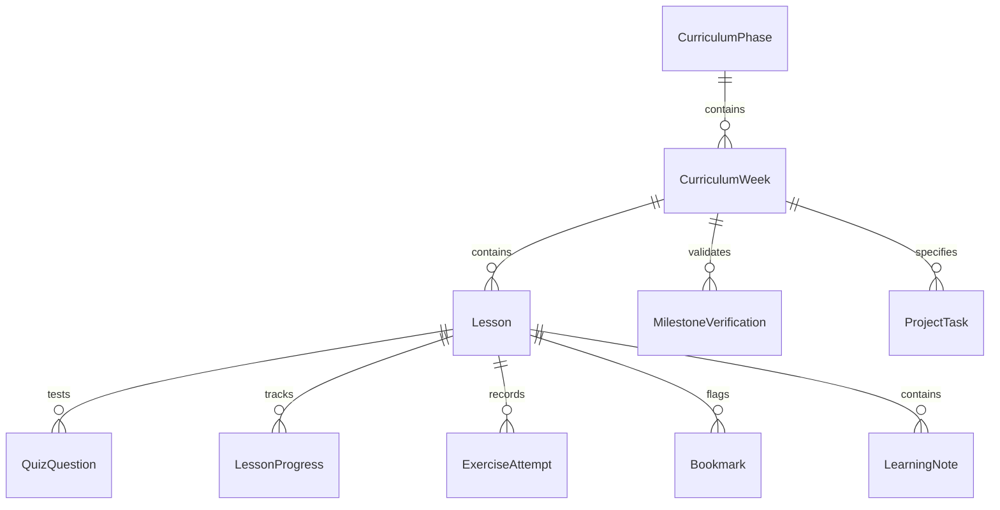

# NeuroMatrix Learning Academy — Architecture Specification

## 1. System Overview

**NeuroMatrix Learning Academy** is a production-grade full-stack web application designed to deliver, organize, and track a comprehensive 112-day Python full-stack learning journey. The architecture connects foundational Python programming to distributed systems engineering, mobile clients, and production operations within the NeuroMatrix ecosystem.

```
                    +------------------------------------------+
                    |          React 18 + TypeScript           |
                    |           (Tailwind + Vite SPA)          |
                    +--------------------+---------------------+
                                         |
                                HTTP / JSON REST
                                         |
                    +--------------------v---------------------+
                    |            FastAPI ASGI Core             |
                    |             (Python 3.13)                |
                    +--------------------+---------------------+
                                         |
                          SQLAlchemy 2.0 Async (aiosqlite)
                                         |
                    +--------------------v---------------------+
                    |          Persistent SQLite DB            |
                    |       (Clean Postgres Migration)         |
                    +------------------------------------------+
```

---

## 2. Technology Stack Decisions

| Tier | Technology | Rationale & Specifications |
| :--- | :--- | :--- |
| **Backend** | Python 3.13 + FastAPI + Uvicorn | Async ASGI architecture, Pydantic v2 validation, autogenerated OpenAPI documentation (`/docs`), high I/O throughput. |
| **ORM / Data** | SQLAlchemy 2.0 Async + aiosqlite | Modern `Mapped[]` and `mapped_column()` declarative typing, async session pooling, seamless migration path to PostgreSQL (`asyncpg`). |
| **Frontend** | React 18 + TypeScript + Vite | Type-safe declarative UI, component-level state isolation, instantaneous HMR via Vite, optimized production bundling. |
| **Styling** | Tailwind CSS (v3.4) | Cybersecurity-inspired dark design system: deep charcoal bases (`#07090b`, `#0d1117`), restrained emerald green (`#10b981`), terminal monospace typography (`JetBrains Mono`). |
| **Testing** | Pytest + pytest-asyncio + HTTPX | Full async integration and unit test suite with in-memory SQLite isolation. |
| **Quality** | Ruff + TypeScript (`tsc`) | Fast Python linter and formatter alongside strict TypeScript type-checking (`noUnusedLocals`, `strict`). |

---

## 3. Persistent Data Model & Schema

All learning state is persisted to SQLite (`neuromatrix_academy.db`), designed for zero data loss and migration to PostgreSQL.

### Entity Relationship Model



### Table Specifications

1. **`curriculum_phases`**: High-level program divisions (Phases 1 through 4).
   - `phase_number` (INT, PK)
   - `title`, `weeks_range`, `days_range`, `description`, `focus_area`
2. **`curriculum_weeks`**: Weekly milestones (Weeks 1 through 16).
   - `week_number` (INT, PK)
   - `phase_number` (INT, FK -> curriculum_phases.phase_number)
   - `title`, `days_range`, `summary`, `milestone_title`, `milestone_description`, `milestone_criteria` (JSON)
3. **`lessons`**: The 112 individually addressable days.
   - `id` (VARCHAR(50), PK, e.g. `day-001` through `day-112`)
   - `day_number` (INT, UNIQUE, INDEX, 1..112)
   - `week_number` (INT, FK -> curriculum_weeks.week_number)
   - `phase_number` (INT)
   - `title`, `slug`, `summary`, `duration_minutes`
   - `objectives` (JSON list)
   - `prerequisites` (JSON list)
   - `revision_questions` (JSON list)
   - `concept_sections` (JSON list of objects: title, content, key_points)
   - `code_examples` (JSON list of objects: title, description, code, language, expected_output)
   - `exercises` (JSON list of objects: id, title, difficulty, instructions, starter_code, solution_code, expected_output, acceptance_criteria, test_cases)
   - `common_errors` (JSON list of objects: error_type, cause, fix, example)
   - `edge_cases` (JSON list of strings)
   - `neuromatrix_integration` (JSON object: topic, context, task_description, target_component, verification_step)
   - `completion_criteria` (JSON list)
4. **`quiz_questions`**: Conceptual and code-reading questions.
   - `id` (VARCHAR(60), PK)
   - `lesson_id` (FK -> lessons.id, INDEX)
   - `day_number` (INT, INDEX)
   - `question_text`, `question_type` (mcq, code_reading, output_prediction, debugging)
   - `code_snippet` (TEXT, optional)
   - `options` (JSON list of strings)
   - `correct_answer` (VARCHAR(200))
   - `explanation` (TEXT)
5. **`lesson_progress`**: Individual day completion status.
   - `id` (INT, PK, AUTOINCREMENT)
   - `user_id` (VARCHAR(100), INDEX)
   - `lesson_id` (FK -> lessons.id, INDEX)
   - `day_number` (INT, INDEX)
   - `status` (VARCHAR(20): `not_started`, `in_progress`, `completed`)
   - `started_at`, `completed_at`, `last_accessed_at` (TIMESTAMP)
6. **`exercise_attempts`**: Local execution attempt records.
   - `id` (INT, PK, AUTOINCREMENT)
   - `user_id`, `lesson_id`, `exercise_id`, `status`, `submitted_output`, `notes`, `attempted_at`
7. **`quiz_attempts`**: Individual question score tracking.
   - `id` (INT, PK, AUTOINCREMENT)
   - `user_id`, `lesson_id`, `question_id`, `selected_answer`, `is_correct`, `score`, `attempted_at`
8. **`project_tasks`**: 16 engineering milestone deliverables.
   - `id` (VARCHAR(60), PK)
   - `user_id`, `phase_number`, `week_number`, `linked_day_number`, `title`, `description`
   - `implementation_notes`, `git_commit_ref`, `pr_url`, `test_results`, `remaining_issues`, `status`
9. **`milestone_verifications`**: Formal milestone sign-offs.
   - `id`, `user_id`, `week_number`, `status` (`locked`, `in_progress`, `ready_for_review`, `verified`), `evidence_notes`, `verified_at`
10. **`bookmarks` & `learning_notes`**: Persistent learner knowledge base.

---

## 4. API Architecture & Contracts

All endpoints are prefixed with `/api` and return standardized JSON schemas.

### Route Modules
- `/api/health`: Database connection liveness and service status probe.
- `/api/dashboard/summary`: High-level metrics, active day, weekly milestones, recent activity feed.
- `/api/curriculum/overview`: Full 16-week hierarchy with completion state for every day.
- `/api/curriculum/search`: Keyword, phase, status, and topic filtering across all 112 days.
- `/api/lessons/{day_or_id}`: Full lesson workspace data payload with previous/next pointers.
- `/api/lessons/{day_or_id}/status`: Safe state machine transition endpoint (`not_started`, `in_progress`, `completed`).
- `/api/lessons/{day_or_id}/exercises/{exercise_id}/submit`: Exercise output verification recorder.
- `/api/lessons/{day_or_id}/quiz/submit`: Batch quiz evaluation with explanations and score recording.
- `/api/practice/questions`: Filterable question bank for the Practice Lab.
- `/api/projects`: Milestone task tracking, Git commit references, and PR links.
- `/api/milestones/{week_number}/verify`: Milestone sign-off with verification notes.
- `/api/notes`: Full-text study notes CRUD with Markdown storage.
- `/api/bookmarks`: Day pinning and quick-access revision bookmarks.

---

## 5. Security & Safe Execution Policy

1. **Safe Code Execution**: In strict compliance with security rules, arbitrary user-submitted Python is **never** executed using `eval()`, `exec()`, or unsandboxed subprocesses inside the server process. Learners execute code locally in their secure terminal and submit verified outputs to the verification logger.
2. **CORS Security**: Cross-Origin Resource Sharing is configured with explicit origins (`settings.CORS_ORIGINS`).
3. **SPA Fallback Routing**: Direct browser navigation (e.g. `/curriculum/50`) is safely handled by an ASGI catch-all handler that serves `frontend/dist/index.html` while preserving 404 boundaries for missing `/api/` endpoints.
4. **Idempotent Seeding**: Curriculum seed operations update records without duplicating entities or wiping learner progress.
